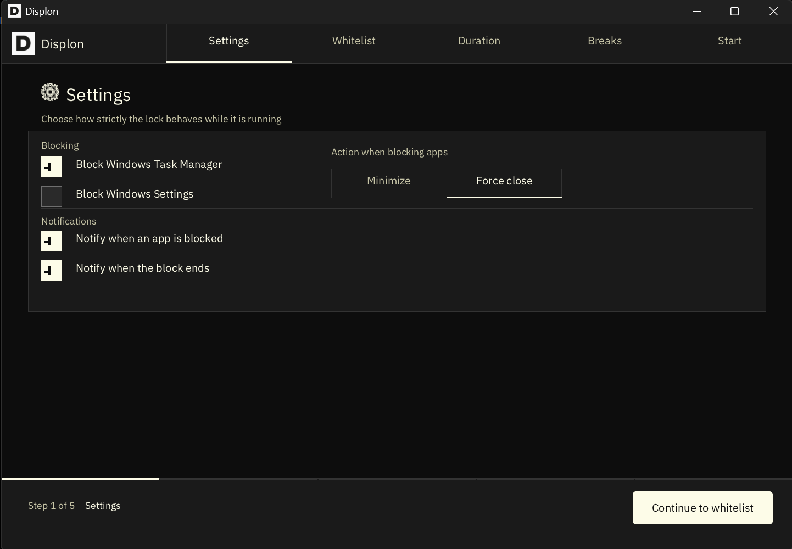
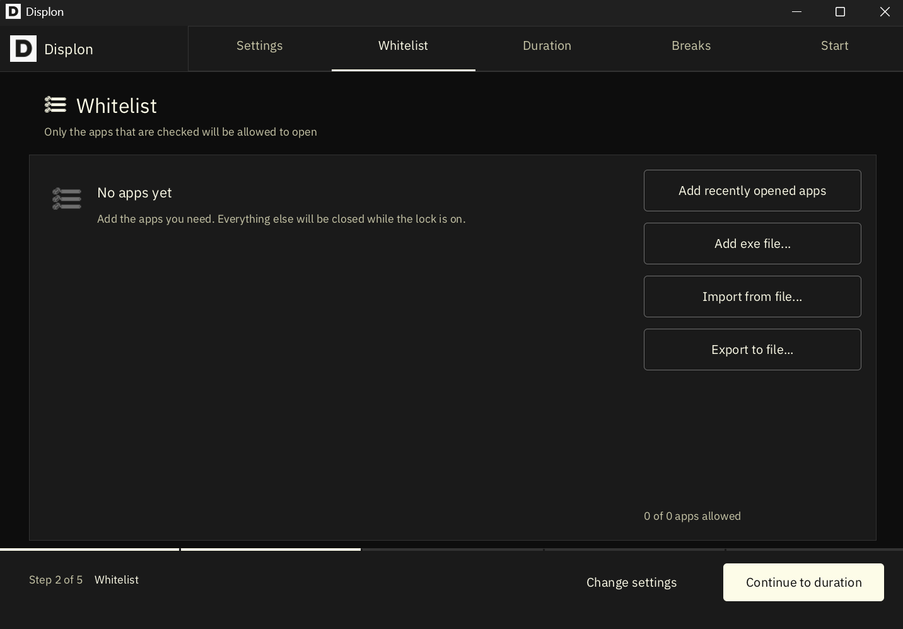
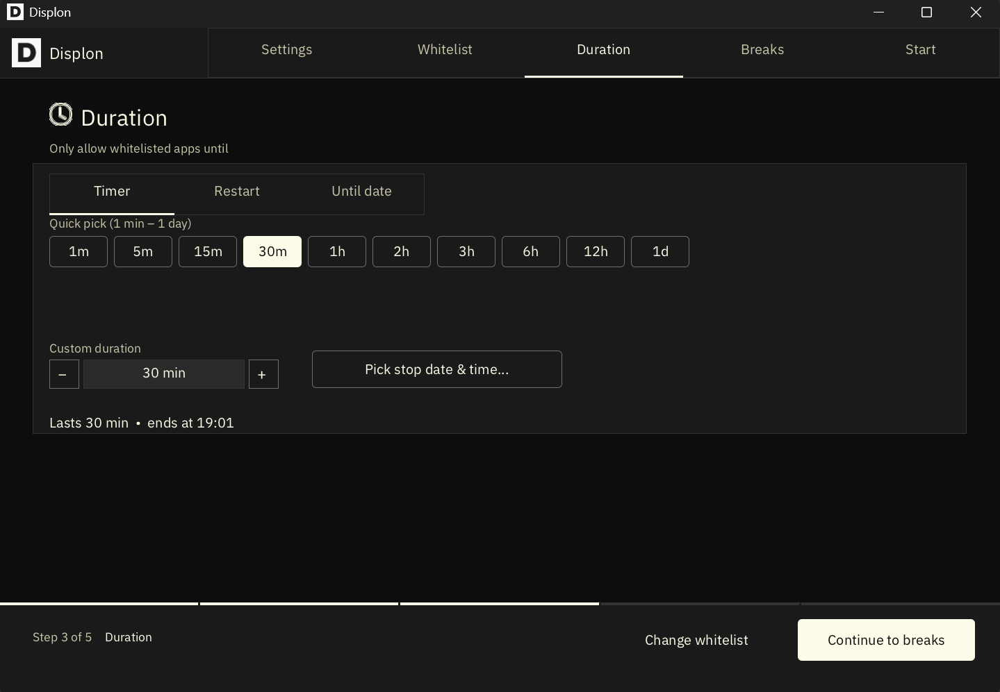
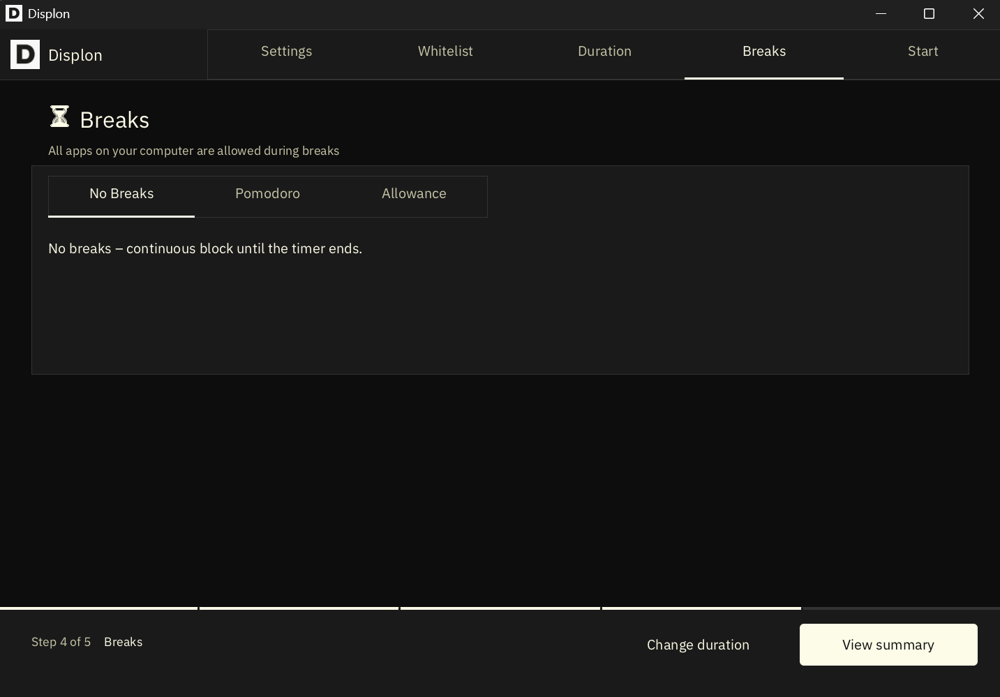
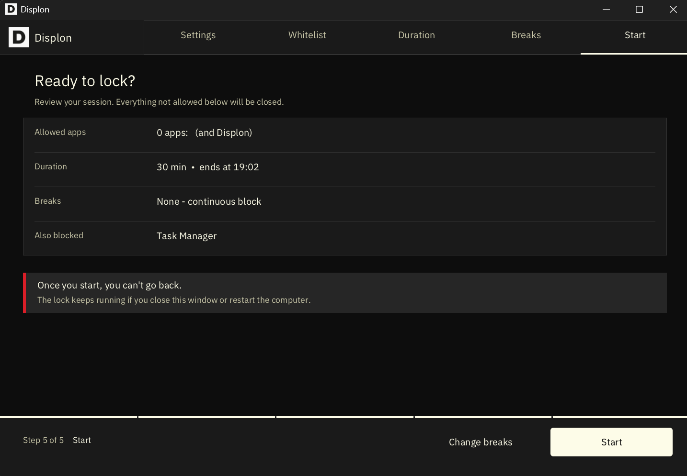
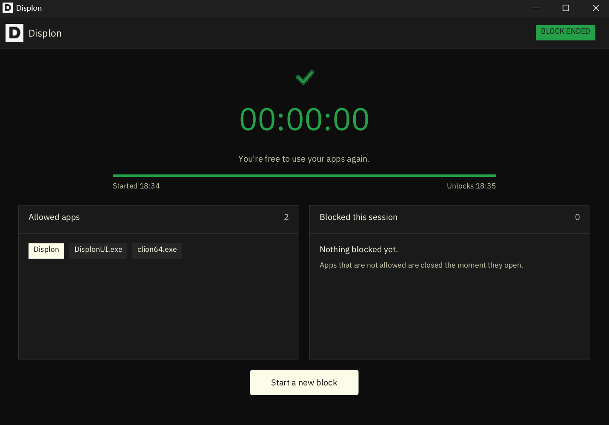

# Displon – Free Open Source Focus App & Distraction Blocker for Windows [](https://github.com/withlimon/displon/actions/workflows/ci.yml)
**Displon** is a free, open source native Windows app that lets you run only the applications you list. It helps you stop multitasking and focus on a single task with Pomodoro and schedule-based blocking.

> [!WARNING]
> Displon is tested on several Windows 11 devices. Windows 10 support is still under testing.I am also trying to add more features.

## Features
* Import / export app list from file
* Pomodoro-based blocking
* Schedule-based blocking
* Windows Settings and Task Manager block
* Autostart block, even if killed from Task Manager or after a system restart
* Uninstallation block during lockout
* Block time tracking
* Custom block duration, from 1 minute to any time range
* Autoswitch between dark and light mode based on system setting

## Screenshots
### Settings 

### Whitelist 

### Duration 

### Breaks

### Confirmation 

### Lock Finish 


## System Requirements
* Operating system: Windows 10 / 11 (x64)
* Storage: 20 MB
* RAM: 100 MB
* GPU: Not required

## Installation
### Install with Scoop
To install Displon,open Poweshell im Administration mode and type:
```bash
scoop bucket add displon https://github.com/withlimon/displon
scoop install displon
```
You can update easily later by:
```bash
scoop update displon
```
You can uninstall it by:
```bash
scoop uninstall displon
```

### Install with Chocolatey
To install Displon, open PowerShell in Administrator mode and type:
```bash
choco install displon
```
You can update easily later by:
```bash
choco upgrade displon
```
You can uninstall it by:
```bash
choco uninstall displon
```
<!--

### Install with winget
To install Displon, open PowerShell in Administrator mode and type:
```bash
winget install withlimon.Displon
```
You can update easily later by:
```bash
winget upgrade withlimon.Displon
```
You can uninstall it by:
```bash
winget uninstall withlimon.Displon
```
-->


### Download from Github Releases
* [Displon x64 Windows](https://github.com/withlimon/displon/releases/latest)

## Support / Critical Bug
Open an [issue](https://github.com/withlimon/displon/issues) or email `limondasplus@gmail.com`.

## License
GNU GPL v3. See [LICENSE](LICENSE).
